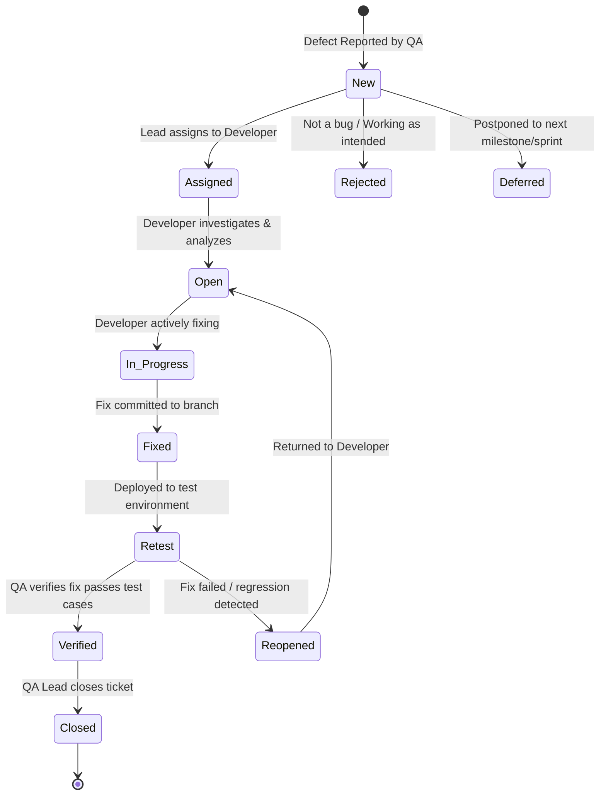

# Exercise 3: Age Field Validation (EP & BVA) & Defect Lifecycle Management

---

## 1. Exercise Objective

1. Apply **Black-Box Test Design Techniques**—specifically **Equivalence Partitioning (EP)** and **Boundary Value Analysis (BVA)**—to validate an age input field with a defined operational range of **18 to 60 (inclusive)**.
2. Implement and test an age validation module ([`academic/age_validator.py`](file:///c:/Users/bhava/Downloads/ST&QA/academic/age_validator.py)) covering valid boundaries, invalid values, negative numbers, extreme inputs, and non-numeric types.
3. Document the standard **Defect Lifecycle (Bug Life Cycle)** state machine, detailing state transitions, responsibilities, entry/exit criteria, and illustrating it with a real defect trace from the SRMS project.

---

## 2. Equivalence Partitioning (EP) Specification

Equivalence Partitioning divides the input domain into classes of data from which test cases can be derived. An assumption is made that all values within a partition are treated equivalently by the software.

| Partition Identifier | Partition Type | Description / Range | Expected Outcome | Representative Value |
|---|---|---|---|:---:|
| **EP-VAL-01** | **Valid Equivalence Partition** | Integers in range: `18 <= Age <= 60` | Accepted (`True`) | `35` |
| **EP-INV-01** | **Invalid Equivalence Partition (Below Min)** | Numeric values: `Age < 18` | Rejected (`False` / `ValueError`) | `14` |
| **EP-INV-02** | **Invalid Equivalence Partition (Above Max)** | Numeric values: `Age > 60` | Rejected (`False` / `ValueError`) | `75` |
| **EP-INV-03** | **Invalid Equivalence Partition (Negative)** | Negative numbers: `Age < 0` | Rejected (`False` / `ValueError`) | `-5` |
| **EP-INV-04** | **Invalid Equivalence Partition (Malformed/Type)**| Non-integers, strings, booleans, `None` | Rejected (`TypeError` / `ValueError`)| `"twenty"`, `None`, `True` |

---

## 3. Boundary Value Analysis (BVA) Specification

Boundary Value Analysis focuses on the values at the boundaries of equivalence classes, where historical data demonstrates that programming defects cluster (off-by-one errors, relational operator misuse).

```
Input Domain Continuum:
 ... 16   [ 17 ]  |  [ 18 ]   [ 19 ]  ...  [ 35 ]  ...  [ 59 ]   [ 60 ]  |  [ 61 ]   62 ...
 <--- Invalid --->|<----------------- Valid Range ----------------->|<--- Invalid --->
```

### Boundary Value Definitions (3-Point BVA)
- **Lower Boundary (`Min = 18`):**
  - Just below lower bound (`Min - 1`): **`17`** (Invalid)
  - On the lower bound (`Min`): **`18`** (Valid)
  - Just above lower bound (`Min + 1`): **`19`** (Valid)
- **Nominal Interior Point:**
  - Mid-range typical value: **`35`** (Valid)
- **Upper Boundary (`Max = 60`):**
  - Just below upper bound (`Max - 1`): **`59`** (Valid)
  - On the upper bound (`Max`): **`60`** (Valid)
  - Just above upper bound (`Max + 1`): **`61`** (Invalid)
- **Extreme Outliers:**
  - **`0`**, **`-1`**, **`150`** (Invalid)

---

## 4. Implementation & Automated Test Matrix

The implementation is located at [`academic/age_validator.py`](file:///c:/Users/bhava/Downloads/ST&QA/academic/age_validator.py).
Automated tests are in [`academic/tests/test_academic_exercises.py::TestExercise3AgeValidation`](file:///c:/Users/bhava/Downloads/ST&QA/academic/tests/test_academic_exercises.py).

| Test Case ID | Test Technique | Input Value | Expected Result | Automated Test Status |
|---|---|:---:|---|:---:|
| **TC-ACAD-03-01** | BVA: Min Boundary (`Min`) | `18` | Returns `(True, "Age 18 is valid")` | **PASS** |
| **TC-ACAD-03-02** | BVA: Just above Min (`Min + 1`)| `19` | Returns `(True, "Age 19 is valid")` | **PASS** |
| **TC-ACAD-03-03** | EP: Interior Nominal Value | `35` | Returns `(True, "Age 35 is valid")` | **PASS** |
| **TC-ACAD-03-04** | BVA: Just below Max (`Max - 1`)| `59` | Returns `(True, "Age 59 is valid")` | **PASS** |
| **TC-ACAD-03-05** | BVA: Max Boundary (`Max`) | `60` | Returns `(True, "Age 60 is valid")` | **PASS** |
| **TC-ACAD-03-06** | BVA: Just below Min (`Min - 1`)| `17` | Returns `(False, "Age must be at least 18")` | **PASS** |
| **TC-ACAD-03-07** | BVA: Just above Max (`Max + 1`)| `61` | Returns `(False, "Age cannot exceed 60")` | **PASS** |
| **TC-ACAD-03-08** | EP: Boundary Zero | `0` | Returns `(False, "Age must be at least 18")` | **PASS** |
| **TC-ACAD-03-09** | EP: Negative Value | `-1` | Returns `(False, "Age must be at least 18")` | **PASS** |
| **TC-ACAD-03-10** | EP: Extreme Outlier High | `75` | Returns `(False, "Age cannot exceed 60")` | **PASS** |
| **TC-ACAD-03-11** | Robustness: Non-numeric String | `"abc"` | Raises `TypeError` / returns `(False, ...)` | **PASS** |
| **TC-ACAD-03-12** | Robustness: Fractional Float | `18.5` | Raises `ValueError("Age must be whole number")` | **PASS** |
| **TC-ACAD-03-13** | Robustness: Boolean Value | `True` | Raises `TypeError` (Boolean guard) | **PASS** |

*All 24 parameterized age validation test assertions passed successfully in 0.09s.*

---

## 5. Defect Lifecycle (Bug Life Cycle) Management

The Defect Lifecycle governs the progression of a software defect from initial discovery through verification and closure.



### 5.1 Comprehensive State Definitions & Responsibilities

1. **New:** 
   - *Condition:* The defect has been discovered by a QA engineer and logged into the tracking system (e.g., Jira, Bugzilla, GitHub Issues).
   - *Deliverable:* Detailed defect report with steps to reproduce, expected vs. actual results, severity, and screenshots/logs.
2. **Assigned:**
   - *Condition:* The QA Lead or Project Manager reviews the ticket and assigns it to the relevant development lead or component engineer.
3. **Open:**
   - *Condition:* The developer starts reviewing the defect description, analyzes stack traces, and reproduces the defect locally.
4. **Rejected / Deferred:**
   - *Rejected:* The behavior complies with specifications, or the issue is non-reproducible.
   - *Deferred:* The bug is valid but low severity, postponed to a future release or milestone.
5. **Fixed:**
   - *Condition:* The developer writes a fix, executes local unit/regression tests, and opens a pull request.
6. **Retest:**
   - *Condition:* The fix is merged and deployed to the staging or test environment. QA begins executing the exact reproducing steps and regression suite.
7. **Reopened:**
   - *Condition:* The defect reproduces on retest, or the patch introduces collateral regressions. The ticket returns to Open.
8. **Verified:**
   - *Condition:* QA confirms that the reproducing test case passes and all regression tests remain green.
9. **Closed:**
   - *Condition:* Formal sign-off. Test evidence is archived, and the ticket is marked Closed.

### 5.2 Real Project Defect Trace: DEF-002 (Grade Boundary Relational Fault)

- **New:** Discovered in `app/services/grading.py::grade_for_percentage` where student with exactly 90.00% received `A2` instead of `A1`. Logged as `DEF-002`, Severity: High.
- **Assigned:** Assigned to Backend Developer for grading services.
- **Open:** Developer analyzed lines 40–55: found `if pct > lower_bound:` instead of `if pct >= lower_bound:`.
- **Fixed:** Relational operator changed to `>=`. Regression test `test_grade_boundaries` added.
- **Retest:** QA executed `pytest tests/unit/test_grading.py -k test_grade_boundaries` against the fix.
- **Verified:** All 8 grade boundary test assertions passed (90% -> A1, 80% -> A2, ..., 35% -> D).
- **Closed:** Verified by QA lead and recorded in [`docs/defects.md`](file:///c:/Users/bhava/Downloads/ST&QA/docs/defects.md). Evidence saved in `docs/evidence/faults/DEF-002-after.txt`.
