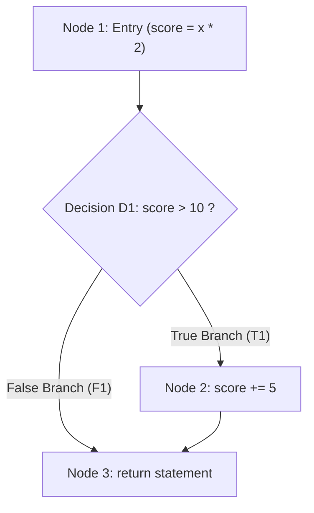

# Exercise 4: White-Box Coverage Analysis & ATM Black-Box Testing

---

## 1. Exercise Objective

1. Provide a rigorous, mathematical, and control-flow comparison between **Statement Coverage** and **Branch (Decision) Coverage**.
2. Prove through concrete code ([`academic/coverage_demo.py`](file:///c:/Users/bhava/Downloads/ST&QA/academic/coverage_demo.py)) and automated tests why **100% Statement Coverage does NOT guarantee 100% Branch Coverage**, demonstrating defect masking.
3. Design and implement a full black-box test suite for an **Automated Teller Machine (ATM) Cash Withdrawal System** ([`academic/atm.py`](file:///c:/Users/bhava/Downloads/ST&QA/academic/atm.py)) using Equivalence Partitioning and Boundary Value Analysis.

---

## 2. Statement Coverage vs. Branch Coverage Analysis

### 2.1 Theoretical Formulations

$$\text{Statement Coverage} = \frac{\text{Number of Executed Statements}}{\text{Total Executable Statements}} \times 100\%$$

$$\text{Branch / Decision Coverage} = \frac{\text{Number of Executed Decision Outcomes (True/False)}}{\text{Total Decision Outcomes (Branches)}} \times 100\%$$

### 2.2 Control Flow Demonstration Code

From [`academic/coverage_demo.py`](file:///c:/Users/bhava/Downloads/ST&QA/academic/coverage_demo.py):
```python
def classify_number(x: int, bonus_mode: bool) -> str:
    # Line 1: Entry
    score = x * 2
    # Decision D1 (Line 3): if score > 10:
    if score > 10:
        score += 5  # Line 4: Executed only on True branch
    # Line 5: Exit
    return "high" if score > 12 else "normal"
```

### 2.3 Control Flow Graph (CFG)



### 2.4 Coverage Subsumption Proof

| Test Suite | Test Inputs | Executed Path | Statements Executed | Statement Coverage | Branches Executed | Branch Coverage | Defects Detected |
|---|---|---|:---:|:---:|:---:|:---:|---|
| **Suite 1 (Statement-Only)** | Test 1: `x = 6` (`score = 12`) | N1 -> D1 (True) -> N2 -> N3 | 4 / 4 | **100%** | 1 / 2 (T1 taken, F1 missed) | **50%** | **Fails to test the False branch!** If the system crashes when `score <= 10`, Suite 1 never discovers it. |
| **Suite 2 (Complete Branch)**| Test 1: `x = 6`<br>Test 2: `x = 3` (`score = 6`) | Path 1: N1 -> D1(T) -> N2 -> N3<br>Path 2: N1 -> D1(F) -> N3 | 4 / 4 | **100%** | 2 / 2 (Both T1 & F1 taken) | **100%** | **Complete decision coverage.** Both decision outcomes verified. |

> [!IMPORTANT]
> **Subsumption Hierarchy:** Branch Coverage strictly *subsumes* Statement Coverage ($C_{\text{branch}} \implies C_{\text{statement}}$). A test suite achieving 100% branch coverage is guaranteed to achieve 100% statement coverage (excluding unreachable dead code), but the reverse is **never true**.

Automated verification in [`academic/tests/test_academic_exercises.py::TestExercise4CoverageAndATM::test_tc_acad_05_coverage_subsets`](file:///c:/Users/bhava/Downloads/ST&QA/academic/tests/test_academic_exercises.py) proves this mathematically.

---

## 3. ATM Cash Withdrawal Black-Box Test Design

### 3.1 Business Rules & Operational Constraints
1. **Multiples of Currency:** Withdrawals must be in exact multiples of ₹100 or $100.
2. **Transaction Limits:** Minimum ₹100; Maximum ₹10,000 per single transaction.
3. **Daily Aggregate Limit:** Maximum ₹20,000 cumulative withdrawal per day.
4. **Account Solvency:** Amount requested cannot exceed available account balance.
5. **Security Authentication:** 3 consecutive incorrect PIN entries immediately locks the card/account.

### 3.2 Equivalence Partitioning (EP) Matrix

| Partition ID | Variable / Dimension | Partition Range / Condition | Expected Behavior |
|---|---|---|---|
| **EP-ATM-01** | Amount Multiplier | Exact multiple of 100 (e.g., 500, 1000) | Valid |
| **EP-ATM-02** | Amount Multiplier | Not a multiple of 100 (e.g., 150, 255) | Invalid: "Amount must be a multiple of 100" |
| **EP-ATM-03** | Single Transaction Range | ₹100 <= Amount <= ₹10,000 | Valid |
| **EP-ATM-04** | Single Transaction Range | Amount < ₹100 | Invalid: "Minimum withdrawal is 100" |
| **EP-ATM-05** | Single Transaction Range | Amount > ₹10,000 | Invalid: "Maximum single withdrawal is 10,000" |
| **EP-ATM-06** | Daily Limit Range | Cumulative Daily Total <= ₹20,000 | Valid |
| **EP-ATM-07** | Daily Limit Range | Cumulative Daily Total > ₹20,000 | Invalid: "Daily withdrawal limit exceeded" |
| **EP-ATM-08** | Account Balance | Amount <= Balance | Valid |
| **EP-ATM-09** | Account Balance | Amount > Balance | Invalid: "Insufficient account balance" |
| **EP-ATM-10** | PIN Authentication | Correct PIN (`"1234"`) | Valid |
| **EP-ATM-11** | PIN Authentication | Incorrect PIN entered 1 or 2 times | Invalid: "Incorrect PIN", increments counter |
| **EP-ATM-12** | PIN Authentication | 3rd consecutive incorrect PIN | Invalid & Locked: "Card locked due to 3 failed attempts" |

### 3.3 Boundary Value Analysis (BVA) Matrix

| Test Case ID | Test Focus | Boundary Point Tested | Test Amount | Account Balance | Expected Outcome |
|---|---|---|:---:|:---:|---|
| **TC-BVA-ATM-01** | Min Transaction | Below Min (`Min - 1`) | ₹99 | ₹5,000 | **REJECTED** (Non-multiple of 100 & below min) |
| **TC-BVA-ATM-02** | Min Transaction | On Min Boundary (`Min`) | **₹100** | ₹5,000 | **ACCEPTED** (Dispenses ₹100) |
| **TC-BVA-ATM-03** | Min Transaction | Just above Min (`Min + 100`) | ₹200 | ₹5,000 | **ACCEPTED** (Dispenses ₹200) |
| **TC-BVA-ATM-04** | Max Transaction | Just below Max (`Max - 100`) | ₹9,900 | ₹25,000 | **ACCEPTED** (Dispenses ₹9,900) |
| **TC-BVA-ATM-05** | Max Transaction | On Max Boundary (`Max`) | **₹10,000** | ₹25,000 | **ACCEPTED** (Dispenses ₹10,000) |
| **TC-BVA-ATM-06** | Max Transaction | Above Max (`Max + 100`) | ₹10,100 | ₹25,000 | **REJECTED** ("Maximum single withdrawal is 10,000") |
| **TC-BVA-ATM-07** | Daily Limit | Exact Daily Limit reached | 2x ₹10,000 | ₹50,000 | **ACCEPTED** (Daily total = ₹20,000) |
| **TC-BVA-ATM-08** | Daily Limit | Exceeds Daily Limit by ₹100 | ₹10,000 + ₹10,000 + ₹100 | ₹50,000 | **REJECTED** ("Daily withdrawal limit of 20,000 exceeded") |
| **TC-BVA-ATM-09** | Exact Balance | Amount == Balance | ₹5,000 | ₹5,000 | **ACCEPTED** (Balance becomes 0) |
| **TC-BVA-ATM-10** | Balance Exceeded | Amount == Balance + ₹100 | ₹5,100 | ₹5,000 | **REJECTED** ("Insufficient account balance") |

---

## 4. Verification & Automated Test Results

The ATM controller is implemented in [`academic/atm.py`](file:///c:/Users/bhava/Downloads/ST&QA/academic/atm.py) and thoroughly tested in [`academic/tests/test_academic_exercises.py`](file:///c:/Users/bhava/Downloads/ST&QA/academic/tests/test_academic_exercises.py):
- `test_tc_acad_04_atm_valid_withdrawal`: Validates single transactions and balance updates.
- `test_tc_acad_04_atm_insufficient_funds_rejected`: Validates overdraft protection.
- `test_tc_acad_04_atm_invalid_amount_rules_rejected`: Parameterized testing for ₹50, ₹150, ₹10,500, -₹500, and ₹0.
- `test_tc_acad_04_atm_daily_limit_enforced`: Validates cumulative ₹20,000 limit across multiple transactions.
- `test_tc_acad_04_atm_pin_lockout_after_3_attempts`: Verifies lockout threshold state transition.
