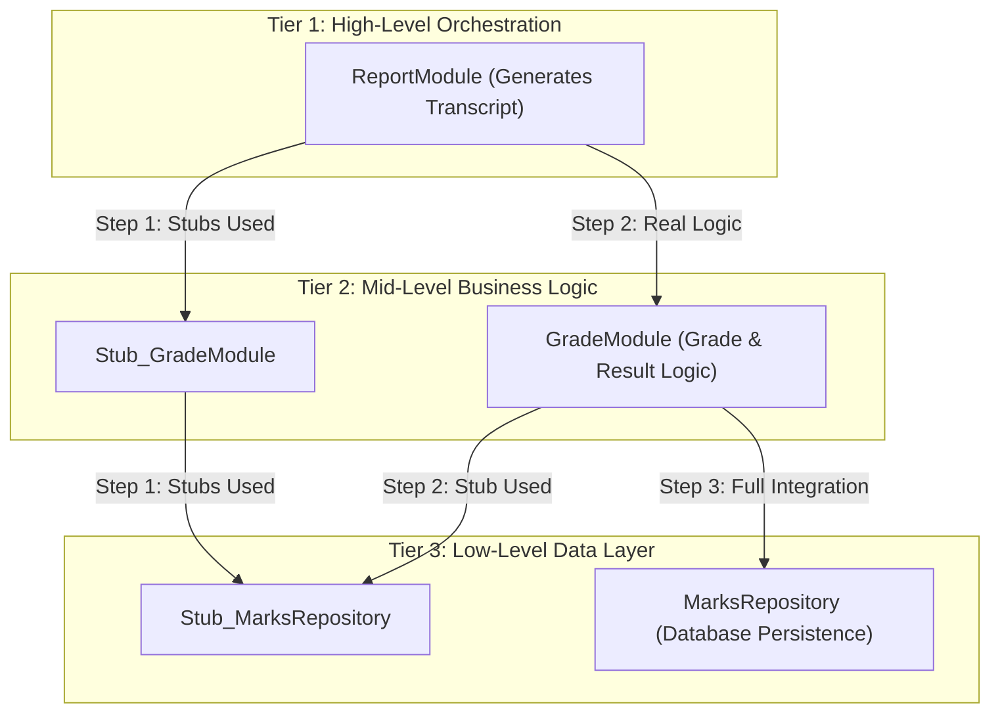

# Exercise 5: Top-Down Integration Testing Strategy & Quality Metrics

---

## 1. Exercise Objective

1. Design and demonstrate an incremental **Top-Down Integration Testing Strategy** using program **stubs**, modeling a multi-tier academic result calculation and reporting architecture.
2. Formulate, explain, and compute essential **Software Quality Assurance Metrics**, including Defect Density, Defect Removal Efficiency (DRE), Test Automation Pass Rates, and Cyclomatic Complexity.
3. Compare Top-Down Integration against Bottom-Up Integration with respect to stub overhead, driver creation, fault localization, and early architectural validation.

---

## 2. Top-Down Integration Architecture & Hierarchy

In Top-Down Integration, testing begins at the highest architectural abstraction tier (e.g., UI or orchestration layer) and progresses downwards toward lower-level data-access modules. Lower-level subordinate modules that are not yet implemented or integrated are substituted with **Stubs** (dummy modules that return hardcoded or canned data simulating actual responses).

---

## 3. Incremental Integration Sequence (3-Step Progression)

The complete code implementation is provided in [`academic/top_down_integration.py`](file:///c:/Users/bhava/Downloads/ST&QA/academic/top_down_integration.py) and verified in [`academic/tests/test_academic_exercises.py::TestExercise5TopDownIntegration`](file:///c:/Users/bhava/Downloads/ST&QA/academic/tests/test_academic_exercises.py).

### Step 1: High-Level Orchestration Isolation with Stubs
- **Modules Under Test:** `ReportModule`
- **Subordinate Modules Replaced by Stubs:** `Stub_GradeModule`, `Stub_MarksRepository`.
- **Purpose:** Validate report rendering formatting, header/footer structure, and orchestration flow without dependency on database queries or grading calculation algorithms.
- **Test:** `test_tc_acad_06_step_1_report_module_with_stubs` -> **PASSED**.

### Step 2: Mid-Level Business Logic Integration
- **Modules Under Test:** `ReportModule` + `GradeModule` (Real Grading Service).
- **Subordinate Modules Replaced by Stubs:** `Stub_MarksRepository`.
- **Purpose:** Verify the interface contract between `ReportModule` and `GradeModule`. Ensures calculation of percentages, grade boundaries, and pass/fail rules integrate seamlessly into transcript generation, while isolating database latency and schema dependencies.
- **Test:** `test_tc_acad_06_step_2_real_grading_with_repo_stub` -> **PASSED**.

### Step 3: Complete Vertical Integration
- **Modules Under Test:** `ReportModule` + `GradeModule` + `MarksRepository` (Live Database / Storage).
- **Subordinate Modules Replaced by Stubs:** None (All stubs removed).
- **Purpose:** Full end-to-end integration verifying data retrieval from persistence tables, accurate transformation by business logic, and presentation in student reports.
- **Test:** `test_tc_acad_06_step_3_full_integration` -> **PASSED**.

---

## 4. Top-Down vs. Bottom-Up Integration Comparison

| Evaluation Metric | Top-Down Integration | Bottom-Up Integration |
|---|---|---|
| **Starting Point** | Main control / High-level modules | Low-level / utility / data-access modules |
| **Supporting Artifacts Required** | Requires **Stubs** (simulating called routines) | Requires **Drivers** (simulating calling routines) |
| **Early System Prototype** | **Yes** — Working skeletal demo available early | **No** — Working system only visible at final phase |
| **Fault Localization** | Good at identifying high-level architectural flaws early | Excellent at pinpointing low-level computational errors |
| **Stub/Driver Overhead** | Writing realistic stubs can become complex if interfaces change | Drivers are generally simpler to write than stubs |
| **Suitability for SRMS** | Ideal for verifying student/teacher workflows early | Applied during Milestone M2 for unit testing grading services |

---

## 5. Software Quality Assurance Metrics

### 5.1 Defect Density

Measures the concentration of defects within a software product relative to its code volume:

$$\text{Defect Density} = \frac{\text{Total Confirmed Defects}}{\text{Size in Thousand Lines of Code (KLOC)}}$$

- **Industry Benchmark:** 1.0 to 5.0 defects / KLOC for commercial systems; < 1.0 defects / KLOC for high-reliability systems.
- **Unit of Measurement:** Defects per KLOC.

### 5.2 Defect Removal Efficiency (DRE)

Quantifies the effectiveness of quality assurance activities in detecting defects prior to customer delivery:

$$\text{DRE} = \frac{D_{\text{pre-release}}}{D_{\text{pre-release}} + D_{\text{post-release}}} \times 100\%$$

- Where $D_{\text{pre-release}}$ is defects caught during development and internal QA testing, and $D_{\text{post-release}}$ is defects reported by users in production.
- **Target Threshold:** $\text{DRE} \ge 95\%$ indicates robust testing and inspection processes.

### 5.3 Test Execution Pass Rate & Automation Rate

$$\text{Test Pass Rate} = \frac{\text{Passed Tests}}{\text{Total Executed Tests}} \times 100\%$$

$$\text{Automation Coverage} = \frac{\text{Automated Test Cases}}{\text{Total Test Cases}} \times 100\%$$

### 5.4 McCabe's Cyclomatic Complexity

Quantifies the structural complexity of a program's control flow graph, indicating the minimum number of linearly independent paths:

$$V(G) = E - N + 2P$$

- Where $E$ is edges, $N$ is nodes, and $P$ is connected components (typically $P=1$).
- **Rule of Thumb:** $V(G) \le 10$ is simple and easily testable; $V(G) > 20$ represents high risk requiring refactoring.
