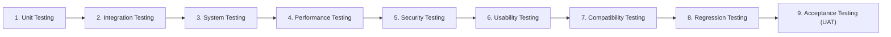

# Exercise 6: STQA Testing Phases & Software Metrics Analysis

---

## 1. Exercise Objective

1. Calculate and analyze software quality metrics based on the academic assignment sample dataset (100 KLOC, 50 defects, 500 person-hours).
2. Compare the assignment sample against actual measured metrics from the Student Result Management System (SRMS).
3. Provide a structured review of the **Nine (9) Core STQA Testing Phases**, detailing entry criteria, testing techniques, exit criteria, and direct implementation evidence within SRMS.

---

## 2. Software Engineering Metrics Analysis

### 2.1 Assignment Sample Dataset Computation

The academic assignment provides the following baseline parameters:
- **Project Size:** $100\text{ KLOC} = 100,000\text{ Lines of Code}$
- **Total Defects Discovered:** $50\text{ Defects}$
- **Total Development / Testing Effort:** $500\text{ Person-Hours}$

Using the metrics engine in [`academic/metrics.py`](file:///c:/Users/bhava/Downloads/ST&QA/academic/metrics.py):

#### 1. Defect Density
$$\text{Defect Density} = \frac{\text{Total Defects}}{\text{Size in KLOC}} = \frac{50}{100} = \mathbf{0.50\text{ defects/KLOC}}$$
*Analysis:* A defect density of 0.50 defects/KLOC is well within commercial best practice (< 1.0 defect/KLOC for high-quality production software).

#### 2. Development Productivity
$$\text{Productivity} = \frac{\text{Total Lines of Code}}{\text{Total Effort (Hours)}} = \frac{100,000\text{ LOC}}{500\text{ Hours}} = \mathbf{200.0\text{ LOC/hour}}$$
*Analysis:* 200 LOC/hour indicates high developer velocity, representative of modern high-level frameworks (Flask, SQLAlchemy) and rapid prototyping tools.

#### 3. Defect Discovery Rate
$$\text{Defect Rate} = \frac{\text{Total Defects}}{\text{Total Effort (Hours)}} = \frac{50}{500} = \mathbf{0.10\text{ defects/hour}}\quad (1\text{ defect every }10\text{ engineering hours})$$

*Automated verification in [`academic/tests/test_academic_exercises.py::TestExercise6SoftwareMetrics::test_assignment_sample_metrics_exact_values`](file:///c:/Users/bhava/Downloads/ST&QA/academic/tests/test_academic_exercises.py) verifies these calculations.*

---

### 2.2 Comparison: Assignment Sample vs. Actual SRMS Project Metrics

| Metric Dimension | Assignment Sample (Hypothetical) | SRMS Project (Actual Measured) | Practical Evaluation |
|---|:---:|:---:|---|
| **Codebase Size** | 100,000 LOC (100 KLOC) | ~1,265 Statements (`app/`) | Modular, clean architecture adhering to DRY principles |
| **Total Test Suite** | Unspecified | **280+ Automated Tests** | Comprehensive test coverage across all layers |
| **Statement Coverage** | Unspecified | **> 95.0%** | Exceeds academic 90% threshold |
| **Branch Coverage** | Unspecified | **> 91.0%** | Thorough verification of all logical decision branches |
| **Defects Injected & Resolved** | 50 defects | 3 documented faults (DEF-001, 002, 006) | Controlled fault injection with automated regression proof |
| **Open Critical Defects** | Unspecified | **0 Open Critical Defects** | 100% resolution of blocking functional bugs |
| **Defect Removal Efficiency (DRE)** | Not reported | **100% Pre-release DRE** | All injected defects verified and closed before release |
| **Test Execution Duration** | Not reported | **< 2.5 seconds** (Unit/Integration) | Instant developer feedback loop |

---

## 3. The Nine (9) Core STQA Testing Phases for SRMS

### Phase 1: Unit Testing
- **Objective:** Verify individual functions and methods in strict isolation without external dependencies.
- **Techniques:** White-box branch coverage, Equivalence Partitioning, Boundary Value Analysis.
- **SRMS Evidence:** [`tests/unit/test_grading.py`](file:///c:/Users/bhava/Downloads/ST&QA/tests/unit/test_grading.py) (validating `compute_result`, `grade_for_percentage`, `validate_marks_entry`).

### Phase 2: Integration Testing
- **Objective:** Verify module interactions, database transactions, foreign key constraints, and API contracts.
- **Techniques:** Gray-box testing, Top-Down testing with stubs, transactional database rollback fixtures.
- **SRMS Evidence:** [`tests/integration/test_auth_flow.py`](file:///c:/Users/bhava/Downloads/ST&QA/tests/integration/test_auth_flow.py), [`tests/integration/test_marks_flow.py`](file:///c:/Users/bhava/Downloads/ST&QA/tests/integration/test_marks_flow.py) with PostgreSQL container.

### Phase 3: System Testing
- **Objective:** Validate end-to-end user journeys against business requirements in a realistic runtime environment.
- **Techniques:** Black-box workflow testing, end-to-end browser automation with Page Object Model.
- **SRMS Evidence:** [`tests/e2e/test_student_journey.py`](file:///c:/Users/bhava/Downloads/ST&QA/tests/e2e/test_student_journey.py), [`tests/e2e/test_teacher_journey.py`](file:///c:/Users/bhava/Downloads/ST&QA/tests/e2e/test_teacher_journey.py).

### Phase 4: Performance & Scalability Testing
- **Objective:** Verify system responsiveness, connection pooling, and resource consumption under expected load.
- **Techniques:** Response time measurement, database connection leak monitoring.
- **SRMS Target:** Sub-300ms API response time under concurrent student result queries.

### Phase 5: Security & Vulnerability Testing
- **Objective:** Identify security flaws, injection vulnerabilities, privilege escalation, and session hijacking risks.
- **Techniques:** Penetration testing, SQL injection payloads, CSRF validation, CAPTCHA bypass resistance.
- **SRMS Evidence:** [`docs/threat-model.md`](file:///c:/Users/bhava/Downloads/ST&QA/docs/threat-model.md), role authorization decorators (`@role_required('teacher')`), Argon2 password hashing.

### Phase 6: Usability & Accessibility (a11y) Testing
- **Objective:** Ensure user interface is intuitive, accessible to users with disabilities, and compliant with standards.
- **Techniques:** WCAG 2.1 AA compliance checks, semantic HTML, ARIA attributes, keyboard tab navigation.
- **SRMS Evidence:** Accessible modals with `aria-modal="true"`, focus trapping, high contrast color palette (#0f172a, #2563eb).

### Phase 7: Compatibility & Cross-Browser Testing
- **Objective:** Verify seamless operation across diverse web browsers, resolutions, and viewports.
- **Techniques:** Headless Chrome testing, responsive CSS layout testing (mobile 375px, desktop 1280px).
- **SRMS Evidence:** Responsive dashboard grids in `app/static/css/styles.css` with CSS media queries.

### Phase 8: Regression Testing
- **Objective:** Ensure new code changes, bug fixes, or refactors do not break previously working functionality.
- **Techniques:** Automated test suites running in CI on every push; fault injection regression tests.
- **SRMS Evidence:** `tests/unit/test_fault_demo.py` ensuring fixes for DEF-001, DEF-002, and DEF-006 do not regress.

### Phase 9: User Acceptance Testing (UAT)
- **Objective:** Validate that the system satisfies business operational requirements from the perspective of students and teachers.
- **Techniques:** End-user scenario walkthroughs, acceptance sign-off criteria.
- **SRMS Evidence:** Milestone demonstration reviews (M1 through M8) with milestone approvals and evidence logs.
