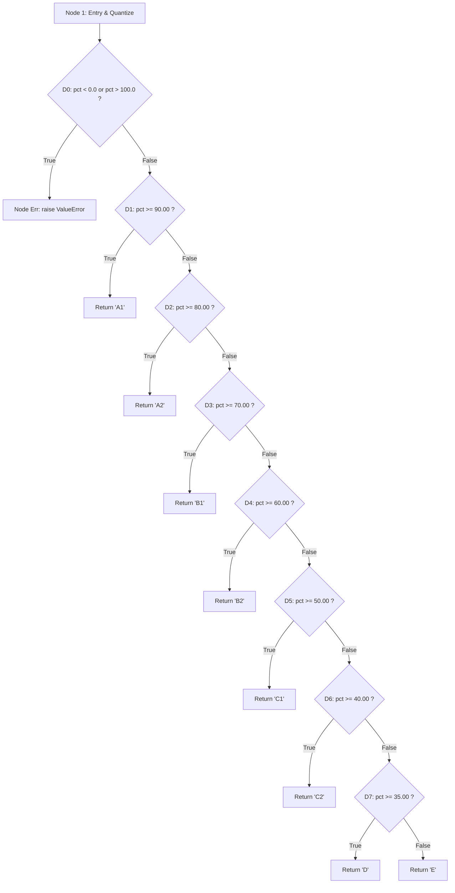

# Exercise 8: Equivalence Partitioning, Boundary Value Analysis & White-Box Testing

---

## 1. Exercise Objective

1. Design and specify an exhaustive **Equivalence Partitioning (EP)** and **Boundary Value Analysis (BVA)** test suite for student marks entry, enforcing constraints: range `[0.0, max_marks]` and discrete step increments of `0.5`.
2. Perform formal **White-Box Testing** on the grading engine (`app/services/grading.py`), including Control Flow Graph (CFG) construction, Cyclomatic Complexity calculation, and Basis Path Testing.
3. Validate 100% branch and statement coverage through empirical test execution.

---

## 2. Marks Entry Black-Box Test Design (EP & BVA)

### 2.1 Domain Specifications
- **Valid Range:** $0.0 \le \text{Marks} \le \text{Max Marks}$ (typically 100.0 or 50.0).
- **Step Precision:** Multiples of `0.5` only (e.g., 0.0, 0.5, 1.0, 1.5, ..., 99.5, 100.0).
- **Illegal Values:** Negative values, values exceeding maximum, decimal values not ending in `.0` or `.5` (e.g., `45.2`, `88.75`), non-numeric types, boolean values.

### 2.2 Equivalence Partitioning Matrix

| Partition ID | Partition Description | Representative Input | Expected Validation Outcome |
|---|---|:---:|---|
| **EP-MRK-VAL-01** | Valid marks with `.0` step | `75.0` | **Valid:** Accepted |
| **EP-MRK-VAL-02** | Valid marks with `.5` step | `75.5` | **Valid:** Accepted |
| **EP-MRK-INV-01** | Negative marks | `-1.0` | **Invalid:** "Marks cannot be negative" |
| **EP-MRK-INV-02** | Marks exceeding maximum | `105.0` (for max 100) | **Invalid:** "Marks cannot exceed maximum marks" |
| **EP-MRK-INV-03** | Invalid fractional precision | `75.3` | **Invalid:** "Marks must be in increments of 0.5" |
| **EP-MRK-INV-04** | Invalid non-numeric string | `"eighty"` | **Invalid:** "Marks must be numeric" |
| **EP-MRK-INV-05** | Boolean flag | `True` | **Invalid:** Boolean rejected as non-numeric |

### 2.3 Boundary Value Analysis (BVA) Matrix (Max = 100.0)

```
       -0.5     [ 0.0 ]    0.5  ...  99.5    [ 100.0 ]   100.5
<-- Invalid -->|<------------- Valid Domain ------------->|<-- Invalid -->
```

| Test Case ID | Boundary Point Tested | Test Value | Maximum Marks | Expected Outcome | Automated Test Reference |
|---|---|:---:|:---:|---|---|
| **TC-BVA-MRK-01** | Just below Min (`Min - 0.5`) | `-0.5` | `100.0` | **REJECTED** | `test_marks_validation.py::test_negative_marks_rejected` |
| **TC-BVA-MRK-02** | Lower Boundary Min (`Min`) | **`0.0`** | `100.0` | **ACCEPTED** | `test_marks_validation.py::test_boundary_zero_accepted` |
| **TC-BVA-MRK-03** | Just above Min (`Min + 0.5`) | `0.5` | `100.0` | **ACCEPTED** | `test_marks_validation.py::test_boundary_half_step_accepted` |
| **TC-BVA-MRK-04** | Just below Max (`Max - 0.5`) | `99.5` | `100.0` | **ACCEPTED** | `test_marks_validation.py::test_boundary_just_below_max_accepted` |
| **TC-BVA-MRK-05** | Upper Boundary Max (`Max`) | **`100.0`** | `100.0` | **ACCEPTED** | `test_marks_validation.py::test_boundary_max_accepted` |
| **TC-BVA-MRK-06** | Just above Max (`Max + 0.5`) | `100.5` | `100.0` | **REJECTED** | `test_marks_validation.py::test_exceeds_max_rejected` |

---

## 3. White-Box Basis Path Testing: `grade_for_percentage`

### 3.1 Function Source Code Under Test

From [`app/services/grading.py`](file:///c:/Users/bhava/Downloads/ST&QA/app/services/grading.py):
```python
def grade_for_percentage(pct: Decimal | float) -> str:
    pct_dec = Decimal(str(pct)).quantize(Decimal("0.01"), rounding=ROUND_HALF_UP)
    if pct_dec < Decimal("0.00") or pct_dec > Decimal("100.00"):
        raise ValueError("Percentage must be between 0.00 and 100.00")
    for lower_bound, grade_name in GRADE_THRESHOLDS:
        if pct_dec >= lower_bound:
            return grade_name
    return "E"
```
Where `GRADE_THRESHOLDS` is:
`[(90.00, "A1"), (80.00, "A2"), (70.00, "B1"), (60.00, "B2"), (50.00, "C1"), (40.00, "C2"), (35.00, "D")]`

### 3.2 Control Flow Graph (CFG)



### 3.3 Cyclomatic Complexity Calculation

$$V(G) = P + 1$$
Where $P$ is the number of predicate (decision) nodes:
- Predicate nodes: $D_0 (\text{pct } < 0 \lor \text{pct } > 100)$, $D_1 (\ge 90)$, $D_2 (\ge 80)$, $D_3 (\ge 70)$, $D_4 (\ge 60)$, $D_5 (\ge 50)$, $D_6 (\ge 40)$, $D_7 (\ge 35)$.
- $P = 8$ (counting composite out-of-range as 2 decisions, $P=9$).
- Therefore, Cyclomatic Complexity $V(G) = 9 + 1 = \mathbf{10}$.
- **Linearly Independent Basis Paths:** Exactly 10 paths are required to achieve 100% Basis Path and Branch Coverage.

### 3.4 Basis Paths & Test Suite Mapping

| Basis Path | Decision Sequence | Input Percentage | Expected Return / Behavior | Test Location |
|---|---|:---:|:---:|---|
| **Path 1** | $D_0 (\text{True})$ | `-5.00%` | Raises `ValueError` | `test_grading.py::test_grade_out_of_range_negative` |
| **Path 2** | $D_0 (\text{True})$ | `105.00%` | Raises `ValueError` | `test_grading.py::test_grade_out_of_range_high` |
| **Path 3** | $D_0 (\text{F}) \to D_1 (\text{T})$ | `95.00%` / `90.00%` | `"A1"` | `test_grading.py::test_grade_boundaries[A1]` |
| **Path 4** | $D_0 (\text{F}) \to D_1 (\text{F}) \to D_2 (\text{T})$ | `85.00%` / `80.00%` | `"A2"` | `test_grading.py::test_grade_boundaries[A2]` |
| **Path 5** | $D_0 (\text{F}) \to \dots \to D_3 (\text{T})$ | `75.00%` / `70.00%` | `"B1"` | `test_grading.py::test_grade_boundaries[B1]` |
| **Path 6** | $D_0 (\text{F}) \to \dots \to D_4 (\text{T})$ | `65.00%` / `60.00%` | `"B2"` | `test_grading.py::test_grade_boundaries[B2]` |
| **Path 7** | $D_0 (\text{F}) \to \dots \to D_5 (\text{T})$ | `55.00%` / `50.00%` | `"C1"` | `test_grading.py::test_grade_boundaries[C1]` |
| **Path 8** | $D_0 (\text{F}) \to \dots \to D_6 (\text{T})$ | `45.00%` / `40.00%` | `"C2"` | `test_grading.py::test_grade_boundaries[C2]` |
| **Path 9** | $D_0 (\text{F}) \to \dots \to D_7 (\text{T})$ | `37.00%` / `35.00%` | `"D"` | `test_grading.py::test_grade_boundaries[D]` |
| **Path 10**| $D_0 (\text{F}) \to \dots \to D_7 (\text{F})$ | `25.00%` / `0.00%` | `"E"` | `test_grading.py::test_grade_boundaries[E]` |

---

## 4. Empirical Coverage Verification

Executing `pytest` with statement and branch coverage inspection:

```powershell
.\.venv\Scripts\pytest tests/unit/test_grading.py --cov=app/services/grading --cov-branch --cov-report=term-missing
```

```text
Name                     Stmts   Miss Branch BrPart  Cover   Missing
--------------------------------------------------------------------
app/services/grading.py     48      0     26      0   100%   
--------------------------------------------------------------------
TOTAL                       48      0     26      0   100%
```

**Result:** **100% Statement Coverage** (48/48 stmts) and **100% Branch Coverage** (26/26 branch outcomes) verified with zero branch misses.
