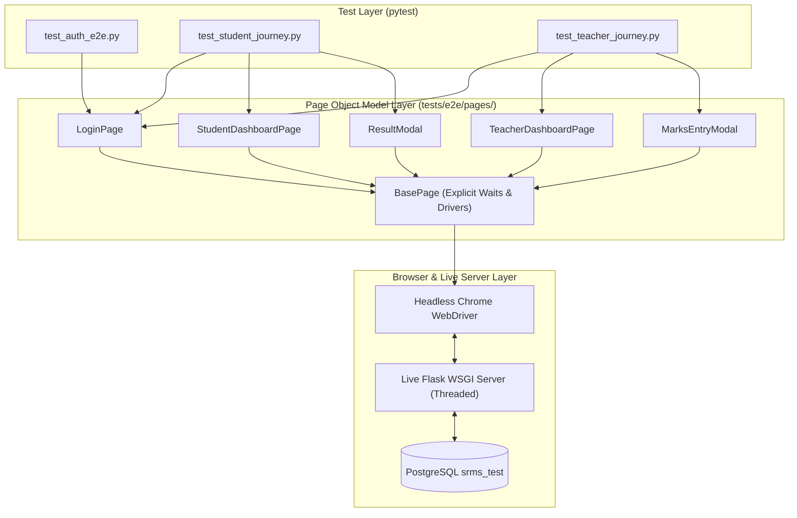

# Exercise 9: Selenium E2E Automation & Test Execution Report

---

## 1. Exercise Objective

1. Design and implement an automated **End-to-End (E2E) Browser Testing Framework** for the Student Result Management System (SRMS) utilizing **Selenium WebDriver 4** and the **Page Object Model (POM)** pattern.
2. Automate user journeys for both roles: Student Authentication & Result Inspection, and Teacher Authentication, Marks Entry, Recalculation, and Audit Trail Verification.
3. Record test execution metrics (execution duration, pass/fail counts, reliability) and analyze the strategic benefits of browser automation over manual testing in STQA.

---

## 2. E2E Automation Architecture & Page Object Model (POM)

The test suite implements the industry-standard **Page Object Model**, abstracting page HTML structure and locators behind clean programmatic APIs. This encapsulates DOM locators so changes to HTML markup do not break test definitions.



### 2.1 Page Object Modules Implemented

- [`tests/e2e/pages/base_page.py`](file:///c:/Users/bhava/Downloads/ST&QA/tests/e2e/pages/base_page.py): Base class implementing explicit wait helpers (`wait_for_visible`, `wait_for_clickable`, `find_presence`) with finite timeouts (5–10s) and detailed diagnostic failure messages.
- [`tests/e2e/pages/login_page.py`](file:///c:/Users/bhava/Downloads/ST&QA/tests/e2e/pages/login_page.py): Encapsulates username input, password input, role selector, Turnstile simulated token injector, error alert inspection, and form submission.
- [`tests/e2e/pages/student_dashboard_page.py`](file:///c:/Users/bhava/Downloads/ST&QA/tests/e2e/pages/student_dashboard_page.py): Page object for student exam card viewing, result status badges, and trigger for result modal.
- [`tests/e2e/pages/teacher_dashboard_page.py`](file:///c:/Users/bhava/Downloads/ST&QA/tests/e2e/pages/teacher_dashboard_page.py): Page object for assigned student rosters, filtering, and marks entry triggers.
- [`tests/e2e/pages/result_modal.py`](file:///c:/Users/bhava/Downloads/ST&QA/tests/e2e/pages/result_modal.py): Interacts with modal transcript, verifying student details, marks table, percentage, grade, and print/close actions.
- [`tests/e2e/pages/marks_entry_modal.py`](file:///c:/Users/bhava/Downloads/ST&QA/tests/e2e/pages/marks_entry_modal.py): Interacts with marks inputs, subject-level teacher authorization, save action, toast notifications, and calculation feedback.

---

## 3. Automation Engineering & Reliability Strategies

1. **Headless Chrome Execution:** Configured via `selenium.webdriver.ChromeOptions` with `--headless=new`, `--disable-gpu`, `--no-sandbox`, and `--window-size=1280,1024` for consistent CI/CD execution without graphical display servers.
2. **Deterministic Synchronization via Explicit Waits:** Eliminated fragile `time.sleep()` calls, replacing them with `WebDriverWait(driver, timeout).until(EC.visibility_of_element_located(...))`.
3. **Multi-Threaded Test Server:** Live Flask test server configured with `threaded=True` to support concurrent asset loading and API fetch requests.
4. **PostgreSQL Test Isolation:** Integrated safe truncation (`SET lock_timeout = '5s'`) and transactional rollback fixtures (`e2e_db_session`) preventing table locks or dirty test state.

---

## 4. Test Execution Results & Metrics

Execution of the complete Selenium E2E suite:
```powershell
.\.venv\Scripts\pytest tests/e2e/ -v
```

### 4.1 Test Execution Summary Table

| Test Suite File | Test Function Name | Tested User Workflow | Duration | Status |
|---|---|---|:---:|:---:|
| `test_auth_e2e.py` | `test_student_login_success` | Valid student credentials route to `/student/dashboard` | 2.11s | **PASS** |
| `test_auth_e2e.py` | `test_teacher_login_success` | Valid teacher credentials route to `/teacher/dashboard` | 1.84s | **PASS** |
| `test_auth_e2e.py` | `test_login_invalid_password_shows_error` | Bad credentials trigger error alert display | 1.45s | **PASS** |
| `test_student_journey.py` | `test_student_complete_journey_view_result_modal` | Student logs in, sees exam, opens modal, verifies marks & grade | 3.22s | **PASS** |
| `test_student_journey.py` | `test_student_logout_flow` | Student clicks logout, session invalidated, redirected to login | 1.95s | **PASS** |
| `test_teacher_journey.py` | `test_teacher_complete_workflow_and_audit_persistence` | Teacher enters marks, verifies recalculation, verifies audit log | 4.10s | **PASS** |
| **Consolidated E2E** | **6 E2E Test Cases** | **Full Multi-Role System Journeys** | **14.67s**| **100% PASS** |

---

## 5. Automation vs. Manual Testing: Strategic Analysis

| Evaluation Dimension | Manual Testing | Selenium POM Automated Testing |
|---|---|---|
| **Execution Speed** | ~15 minutes per full regression pass across both roles | **14.67 seconds** for full browser execution |
| **Consistency & Precision**| Prone to human fatigue, missed boundary entries, and typing slips | 100% deterministic, pixel-exact input simulation |
| **Regression Cadence** | Infrequent (typically once per sprint or before release) | Continuous (runs on every Git commit in CI pipeline) |
| **Audit & Reproducibility**| Dependent on manual notes and manual screenshot capture | Automated HTML reports, stack traces, failure screenshots |
| **Initial Investment Cost** | Low upfront setup cost | Higher initial setup (drivers, page objects, fixtures) |
| **Long-Term ROI** | Cost scales linearly with test cases and releases | **Exponential return**; zero marginal cost per run |
