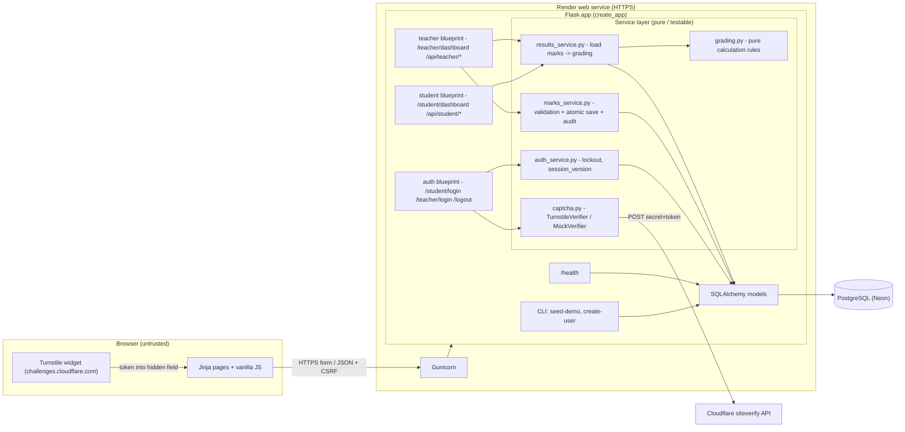
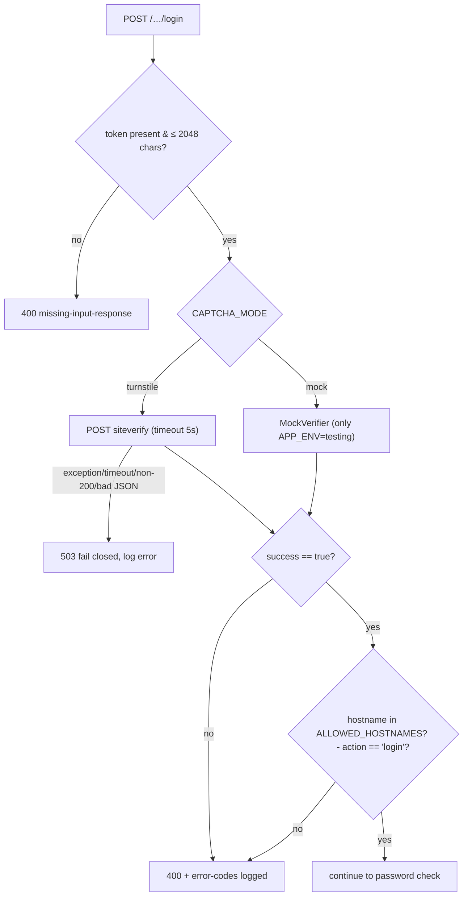
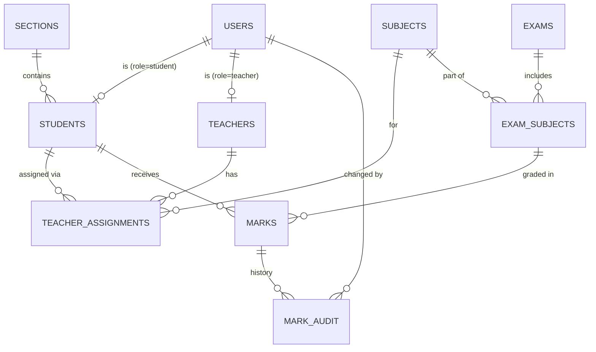
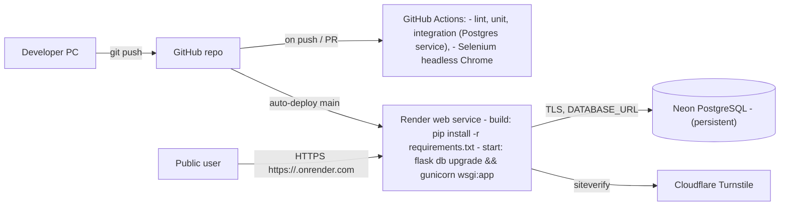
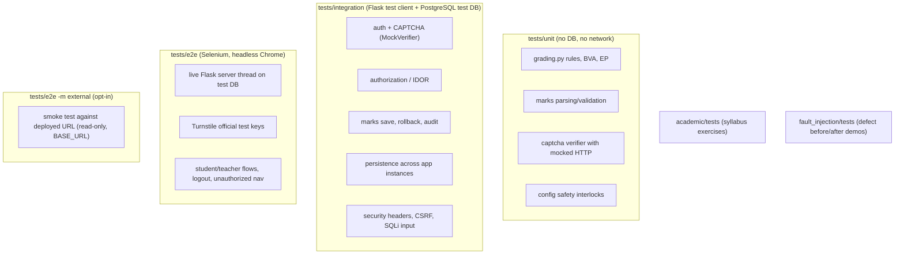
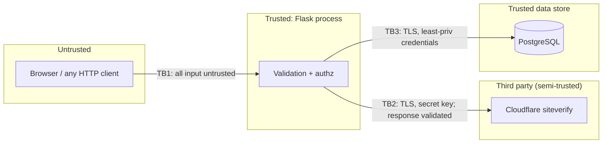

# Architecture — Student Result Management System (SRMS)

> Phase 1 draft — awaiting approval. Related: [requirements.md](requirements.md), [database-schema.md](database-schema.md), [api-design.md](api-design.md), [test-plan.md](test-plan.md).

## 1. Technology stack and justification

| Layer | Choice | Notes |
|---|---|---|
| Frontend | Server-rendered Jinja2 HTML + vanilla CSS + vanilla JS (`fetch`) | No SPA framework needed. JS only for marks editing, result modal, loading states. |
| Backend | Python 3.11, Flask 3.x (application factory + blueprints) | |
| Auth/session | Flask-Login + Flask signed cookie session, `session_version` revocation | No extra session store required. |
| CSRF | Flask-WTF `CSRFProtect` | Forms use hidden field; JSON calls send `X-CSRFToken` header. |
| Password hashing | Werkzeug `generate_password_hash` (scrypt) | Already a Flask dependency. |
| ORM / migrations | Flask-SQLAlchemy 3.x (SQLAlchemy 2.x) + Flask-Migrate (Alembic) | |
| DB driver | `psycopg[binary]` 3.x | |
| Database | PostgreSQL 16 (local: Docker; CI: GitHub Actions service; prod: managed Postgres) | |
| CAPTCHA | Cloudflare Turnstile | Rationale in §4.1. |
| HTTP client | `requests` (for siteverify, 5 s timeout) | |
| WSGI server | Gunicorn (Linux hosts) | Local dev on Windows uses `flask run`. |
| Tests | pytest, pytest-cov, pytest-html, Selenium 4 (Selenium Manager auto-resolves drivers) | |
| CI | GitHub Actions | |
| Hosting (proposed) | **Render** (web service) + **Neon** (managed PostgreSQL) | See §7; pending your decision. |

No change from the requested stack, apart from the *additions* Flask-Login, Flask-WTF, gunicorn, requests, pytest-html — all small, standard libraries.

## 2. Component architecture



### 2.1 Proposed source layout

```
app/
  __init__.py          create_app(), security headers, error handlers, startup config checks
  config.py            Development / Testing / Production config classes, GRADING settings
  extensions.py        db, migrate, login_manager, csrf
  models.py            ORM models
  auth/routes.py       login (student/teacher), logout
  student/routes.py    dashboard page + JSON result API
  teacher/routes.py    dashboard page + JSON students/marks APIs
  services/
    grading.py         pure functions: subject_grade, overall_result, percentage …
    marks_service.py   parse/validate marks, authorised atomic save, audit
    results_service.py build result DTO for a student/exam
    captcha.py         verifier interface, Turnstile + mock implementations
    auth_service.py    authenticate(), lockout, session_version
  cli.py               flask seed-demo / create-user
  templates/  static/css/  static/js/
migrations/            Alembic
academic/              syllabus exercises (separate package, own tests)
fault_injection/       controlled faulty variants + defect demos (never imported by app/)
tests/
  conftest.py  fixtures/  unit/  integration/  e2e/
docs/                  this documentation + evidence/ (actual run outputs)
.github/workflows/ci.yml
docker-compose.yml     local PostgreSQL (dev + test databases)
requirements.txt  requirements-dev.txt  pytest.ini  .env.example  render.yaml  wsgi.py
```

## 3. Authentication and authorization flow

```mermaid
sequenceDiagram
    autonumber
    actor U as User
    participant B as Browser
    participant T as Turnstile widget
    participant A as Flask /student/login
    participant C as Cloudflare siteverify
    participant D as PostgreSQL

    U->>B: open /student/login
    B->>T: render widget (site key)
    T-->>B: token -> hidden field cf-turnstile-response
    U->>B: enter ID + password, submit
    B->>A: POST id, password, token, csrf_token
    A->>A: CSRF check, required-field validation
    alt token missing
        A-->>B: 400 "Please complete the CAPTCHA"
    end
    A->>C: POST secret, token, remoteip, idempotency_key (timeout 5 s)
    alt network error / timeout / malformed
        A-->>B: 503 "Verification service unavailable"
    else success=false or hostname/action mismatch
        A-->>B: 400 "CAPTCHA verification failed"
    end
    A->>D: SELECT user by identifier AND role
    alt user locked (locked_until > now)
        A-->>B: 429 "Too many attempts, try later"
    else bad identifier/password
        A->>D: failed_login_count += 1 (lock if >= 5)
        A-->>B: 401 "Invalid ID or password"
    else ok
        A->>D: reset counter, last_login_at
        A->>A: session.clear(); login_user(); store session_version
        A-->>B: 302 -> /student/dashboard
    end
```

**Per-request authorization**

1. Flask-Login `user_loader` loads the user by ID **and** compares the cookie's `session_version` with the DB value; mismatch ⇒ treated as anonymous.
2. Idle timeout: `session.permanent = True`, `PERMANENT_SESSION_LIFETIME = 30 min`, refreshed on each request.
3. Decorators: `@role_required("student")`, `@role_required("teacher")`. Pages → redirect to login (401 semantics) or 403 page; APIs → JSON 401/403.
4. Object-level checks in the service layer:
   * Student result: `student = current_user.student` — no client ID used.
   * Teacher marks: `TeacherAssignment` must exist for (`current_user.teacher.id`, `student_id`, `subject_id`) for **every** subject in the request; otherwise abort before any write.
5. Logout: `session_version += 1`, `logout_user()`, `session.clear()`.

## 4. CAPTCHA design

### 4.1 Provider choice: Cloudflare Turnstile

| Criterion | Turnstile | Google reCAPTCHA v2 |
|---|---|---|
| Free tier | Free, unlimited | Free up to quota (now under Google Cloud reCAPTCHA) |
| Official test keys | Separate test **site** keys (always pass / always block / force interactive) **and** test **secret** keys (always pass / always fail / "token already spent") | One test key pair (always pass), shows a warning banner |
| Lets us test failure paths E2E without mocks | Yes (fail secret, spent-token secret, block site key) | No |
| Setup | Cloudflare account → Turnstile → add widget (hostname) | Google account / Cloud project |

Turnstile allows deterministic E2E testing of both success **and** failure without solving anything, so it is selected.

Documented test credentials (Cloudflare docs "Testing"):

| Purpose | Site key | Secret key |
|---|---|---|
| Always pass (visible) | `1x00000000000000000000AA` | `1x0000000000000000000000000000000AA` |
| Always block (visible) | `2x00000000000000000000AB` | — |
| Always fail verification | — | `2x0000000000000000000000000000000AA` |
| "Token already spent" (expired/duplicate) | — | `3x0000000000000000000000000000000AA` |

Test site keys produce the dummy token `XXXX.DUMMY.TOKEN.XXXX`; **production secret keys reject this dummy token**, so a misconfigured test site key in production cannot grant access.

### 4.2 Verification flow (server)



### 4.3 Safety interlocks (cannot silently bypass in production)

* `CAPTCHA_MODE=mock` ⇒ startup **raises** unless `APP_ENV=testing`.
* `APP_ENV=production` ⇒ startup **raises** if site/secret keys are missing or match the test-key pattern `^[123]x0{20,}`.
* There is **no** "disabled" mode.
* The `MockVerifier` lives in `app/services/captcha.py` but is constructed only through the guarded factory; a unit test asserts the factory refuses `mock` under `production` and `development`.
* Local development uses Turnstile test keys (real widget + real siteverify call with the always-pass test secret).

## 5. Database relationships (summary — full detail in [database-schema.md](database-schema.md))



## 6. Main routes (full detail in [api-design.md](api-design.md))

| Method | Path | Role |
|---|---|---|
| GET | `/health` | public |
| GET/POST | `/student/login`, `/teacher/login` | anonymous |
| POST | `/logout` | any authenticated |
| GET | `/student/dashboard` | student |
| GET | `/api/student/result?exam_id=` | student (own only) |
| GET | `/teacher/dashboard` | teacher |
| GET | `/api/teacher/students` | teacher |
| GET | `/api/teacher/students/<student_id>/marks?exam_id=` | teacher (assigned) |
| PUT | `/api/teacher/students/<student_id>/marks` | teacher (assigned) |

## 7. Deployment architecture



**Proposed hosting:** Render free web service + Neon free PostgreSQL.

* Render provides HTTPS, Git auto-deploy, env-var management, health checks, logs. Free instances sleep after ~15 min idle (cold start ≈ 30–60 s) — acceptable for a lab demo.
* Render's own free PostgreSQL expires after a limited period, so a separate persistent free Postgres (Neon) is proposed. Alternatives: Render paid Postgres, Railway, Fly.io + managed Postgres, PythonAnywhere (paid Postgres). *Free-tier terms change; they will be re-checked at deployment time.*
* **Migrations:** start command `flask db upgrade && gunicorn …` (Render's pre-deploy hook is not available on free instances). Alembic migrations are idempotent and run inside a transaction on PostgreSQL. Seeding is a **manual** one-off command (Render Shell or local CLI pointed at the prod URL) — never automatic.
* **Proxy:** `ProxyFix(x_for=1, x_proto=1)` so `Secure` cookies / `remote_ip` work behind Render's proxy.
* **Secrets:** set in Render dashboard; `render.yaml` lists keys with `sync: false` (no values).

## 8. Test architecture



* **Test DB isolation:** `TEST_DATABASE_URL` is required; conftest **refuses to run** if it equals `DATABASE_URL` or its database name doesn't contain `test`. Schema created via `alembic upgrade head` once per session (also tests migrations); tables truncated between tests. Factory fixtures create all data.
* **CAPTCHA in tests:** unit tests mock `requests.post`; integration tests use `MockVerifier` (scripted outcomes: success, fail, expired, network error); E2E tests use Turnstile test site key `1x…AA` + secret `1x…AA` (pass) and `2x…AA` (fail) — requires internet (available in GitHub Actions). An offline E2E variant uses `CAPTCHA_MODE=mock` with a stub widget, so E2E can run without internet.
* **Selenium:** explicit `WebDriverWait` only (no `time.sleep`); screenshots + page source saved to `reports/e2e-artifacts/` on failure; `HEADLESS=1` default in CI.
* **Markers:** `unit`, `integration`, `e2e`, `external`, `academic`, `fault_demo`. Default CI run excludes `external` and `fault_demo`.
* **Reports:** `pytest-html` (`reports/*.html`), JUnit XML, `pytest-cov` HTML/XML (branch coverage enabled). Uploaded as CI artifacts; selected real outputs committed to `docs/evidence/`.

## 9. Trust boundaries and security risks



| ID | Risk | Mitigation | Verified by |
|---|---|---|---|
| R-01 | IDOR: student changes ID to read another result | No ID param for students; teacher endpoints check assignment | TC-AUTHZ-03/04/05 |
| R-02 | Teacher edits unassigned student/subject | Per-(student,subject) assignment check before write; atomic | TC-AUTHZ-06/07 |
| R-03 | Client tampers totals/grade/role | Server derives all; extra fields rejected | TC-AUTHZ-09, TC-CALC-15 |
| R-04 | CAPTCHA bypass (missing/forged/replayed token, mock left on) | Server verification, fail-closed, startup interlocks, test-key detection | TC-CAP-* , TC-SEC-08 |
| R-05 | Brute force / credential stuffing | CAPTCHA + 5-attempt lockout | TC-AUTH-12 |
| R-06 | Session hijack / fixation / stale cookie after logout | Secure cookies, session regen, session_version, idle timeout | TC-AUTH-09/10 |
| R-07 | CSRF on marks save / logout | Flask-WTF CSRF on all state-changing requests | TC-SEC-03 |
| R-08 | SQL injection / XSS | ORM bound params, Jinja autoescape, CSP, `textContent` in JS | TC-SEC-01/02 |
| R-09 | Secrets committed | `.gitignore`, `.env.example` placeholders, CI secret scan step (gitleaks) | TC-SEC-07 |
| R-10 | Test suite wipes production data | Test DB guard (name must contain `test`, ≠ `DATABASE_URL`) | TC-DB-07 |
| R-11 | Free-tier DB expiry / cold start | Neon persistent tier; documented cold start | Smoke test |
| R-12 | E2E flakiness (network to Cloudflare, timing) | Explicit waits, retries only on infra errors, offline mock variant | CI |
| R-13 | Demo accounts with known passwords on public URL | Passwords supplied at seed time, not in repo; shared privately with team | Deployment checklist |
| R-14 | Lockout used for denial-of-service on demo accounts | CAPTCHA precedes password check (attacker must solve CAPTCHA per attempt); short 15-min lock; operator CLI `flask unlock-user` | Documented |
