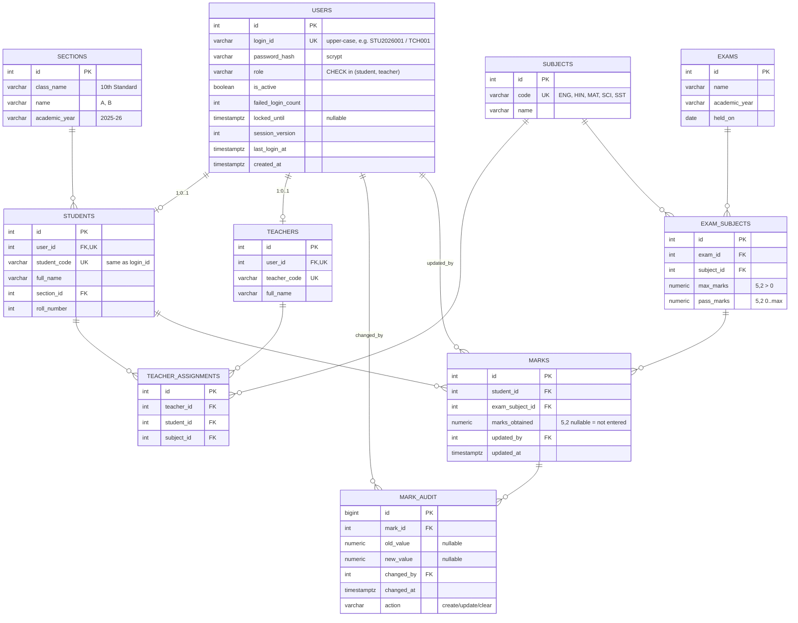

# Database Schema — SRMS (PostgreSQL)

> Phase 1 draft. Implemented with SQLAlchemy 2.x models + Alembic migrations (Flask-Migrate). Normalised to 3NF; calculated values (total, percentage, grade, status) are **not stored** — they are derived from `marks` on every read so they can never drift from the stored marks.

## 1. ER diagram

## 2. Table definitions

### `users`
| Column | Type | Constraints |
|---|---|---|
| id | `SERIAL` | PK |
| login_id | `VARCHAR(32)` | NOT NULL, UNIQUE, `CHECK (login_id = upper(login_id))` |
| password_hash | `VARCHAR(255)` | NOT NULL |
| role | `VARCHAR(16)` | NOT NULL, `CHECK (role IN ('student','teacher'))` |
| is_active | `BOOLEAN` | NOT NULL DEFAULT true |
| failed_login_count | `INTEGER` | NOT NULL DEFAULT 0, `CHECK (>= 0)` |
| locked_until | `TIMESTAMPTZ` | NULL |
| session_version | `INTEGER` | NOT NULL DEFAULT 1 |
| last_login_at | `TIMESTAMPTZ` | NULL |
| created_at | `TIMESTAMPTZ` | NOT NULL DEFAULT now() |

### `sections`
| Column | Type | Constraints |
|---|---|---|
| id | `SERIAL` | PK |
| class_name | `VARCHAR(32)` | NOT NULL (e.g. "10th Standard") |
| name | `VARCHAR(8)` | NOT NULL (e.g. "A") |
| academic_year | `VARCHAR(9)` | NOT NULL (e.g. "2025-26") |
| | | UNIQUE (class_name, name, academic_year) |

### `students`
| Column | Type | Constraints |
|---|---|---|
| id | `SERIAL` | PK |
| user_id | `INTEGER` | NOT NULL, UNIQUE, FK → users.id ON DELETE CASCADE |
| student_code | `VARCHAR(32)` | NOT NULL, UNIQUE |
| full_name | `VARCHAR(120)` | NOT NULL |
| section_id | `INTEGER` | NOT NULL, FK → sections.id ON DELETE RESTRICT |
| roll_number | `INTEGER` | NOT NULL, `CHECK (roll_number > 0)` |
| | | UNIQUE (section_id, roll_number) |

### `teachers`
| Column | Type | Constraints |
|---|---|---|
| id | `SERIAL` | PK |
| user_id | `INTEGER` | NOT NULL, UNIQUE, FK → users.id ON DELETE CASCADE |
| teacher_code | `VARCHAR(32)` | NOT NULL, UNIQUE |
| full_name | `VARCHAR(120)` | NOT NULL |

> Role consistency (a `students` row must reference a user with `role='student'`) is enforced in the service layer and verified by tests; PostgreSQL CHECK constraints cannot reference other tables, and a trigger is deliberately avoided for simplicity.

### `subjects`
| Column | Type | Constraints |
|---|---|---|
| id | `SERIAL` | PK |
| code | `VARCHAR(8)` | NOT NULL, UNIQUE |
| name | `VARCHAR(64)` | NOT NULL, UNIQUE |

### `exams`
| Column | Type | Constraints |
|---|---|---|
| id | `SERIAL` | PK |
| name | `VARCHAR(120)` | NOT NULL |
| academic_year | `VARCHAR(9)` | NOT NULL |
| held_on | `DATE` | NULL |
| | | UNIQUE (name, academic_year) |

### `exam_subjects` (which subjects an exam contains, with their maxima)
| Column | Type | Constraints |
|---|---|---|
| id | `SERIAL` | PK |
| exam_id | `INTEGER` | NOT NULL, FK → exams.id ON DELETE CASCADE |
| subject_id | `INTEGER` | NOT NULL, FK → subjects.id ON DELETE RESTRICT |
| max_marks | `NUMERIC(5,2)` | NOT NULL, `CHECK (max_marks > 0)` |
| pass_marks | `NUMERIC(5,2)` | NOT NULL, `CHECK (pass_marks >= 0 AND pass_marks <= max_marks)` |
| | | UNIQUE (exam_id, subject_id) |

### `teacher_assignments`
| Column | Type | Constraints |
|---|---|---|
| id | `SERIAL` | PK |
| teacher_id | `INTEGER` | NOT NULL, FK → teachers.id ON DELETE CASCADE |
| student_id | `INTEGER` | NOT NULL, FK → students.id ON DELETE CASCADE |
| subject_id | `INTEGER` | NOT NULL, FK → subjects.id ON DELETE RESTRICT |
| | | **UNIQUE (student_id, subject_id)** — exactly one responsible teacher per student-subject |
| | | INDEX (teacher_id) |

### `marks`
| Column | Type | Constraints |
|---|---|---|
| id | `SERIAL` | PK |
| student_id | `INTEGER` | NOT NULL, FK → students.id ON DELETE CASCADE |
| exam_subject_id | `INTEGER` | NOT NULL, FK → exam_subjects.id ON DELETE RESTRICT |
| marks_obtained | `NUMERIC(5,2)` | NULL (= not entered / cleared), `CHECK (marks_obtained >= 0)` |
| updated_by | `INTEGER` | NOT NULL, FK → users.id |
| updated_at | `TIMESTAMPTZ` | NOT NULL DEFAULT now() |
| | | **UNIQUE (student_id, exam_subject_id)** |

> Upper bound (`≤ max_marks`) and the 0.5-step rule are enforced in the service layer (cross-table), and the DB `CHECK (>= 0)` is a defence-in-depth backstop.

### `mark_audit`
| Column | Type | Constraints |
|---|---|---|
| id | `BIGSERIAL` | PK |
| mark_id | `INTEGER` | NOT NULL, FK → marks.id ON DELETE CASCADE |
| action | `VARCHAR(8)` | NOT NULL, `CHECK (action IN ('create','update','clear'))` |
| old_value | `NUMERIC(5,2)` | NULL |
| new_value | `NUMERIC(5,2)` | NULL |
| changed_by | `INTEGER` | NOT NULL, FK → users.id |
| changed_at | `TIMESTAMPTZ` | NOT NULL DEFAULT now() |

## 3. Transactions

* **Marks save** (`PUT /api/teacher/students/<id>/marks`): one DB transaction —
  1. lock the student's mark rows for the exam (`SELECT … FOR UPDATE`),
  2. validate every entry + authorisation for every subject,
  3. upsert `marks`, insert `mark_audit` rows,
  4. `COMMIT`; any exception → `ROLLBACK`, no partial writes.
* **Login failure counter:** single `UPDATE users SET failed_login_count = failed_login_count + 1 …` (atomic increment).
* **Logout:** `UPDATE users SET session_version = session_version + 1`.

## 4. Migrations

* `migrations/` generated by Flask-Migrate; first revision `0001_initial_schema` creates all tables/constraints above.
* Apply: `flask db upgrade` (local, CI, production start command).
* Integration tests run `flask db upgrade` against the test DB at session start, which also verifies migrations apply cleanly.
* Downgrade scripts are provided for the initial revision.

## 5. Demo data (fictional, `flask seed-demo`)

| Entity | Demo content |
|---|---|
| Sections | 10th Standard A, 10th Standard B (2025-26) |
| Subjects | English, Hindi, Mathematics, Science, Social Science |
| Exam | "Annual Examination 2025-26 (Demo)", each subject max 100 / pass 35 |
| Teachers | `TCH001` (English, Mathematics for 10-A), `TCH002` (Hindi, Science, Social Science for 10-A; all subjects for 10-B) |
| Students | ~6 fictional names, e.g. `STU2026001` "Demo Student One", covering PASS / FAIL (one subject < 35) / INCOMPLETE / boundary percentages |

* Passwords: `DEMO_STUDENT_PASSWORD` / `DEMO_TEACHER_PASSWORD` env vars, else interactive prompt. **No defaults are committed for production.** For local dev/test only, the seed may use generated random passwords printed once to the console.
* Idempotent: re-running does not duplicate rows (`--reset` explicitly wipes demo rows; blocked in production).
* Names are obviously fictional ("Demo Student One"); no real personal data.
