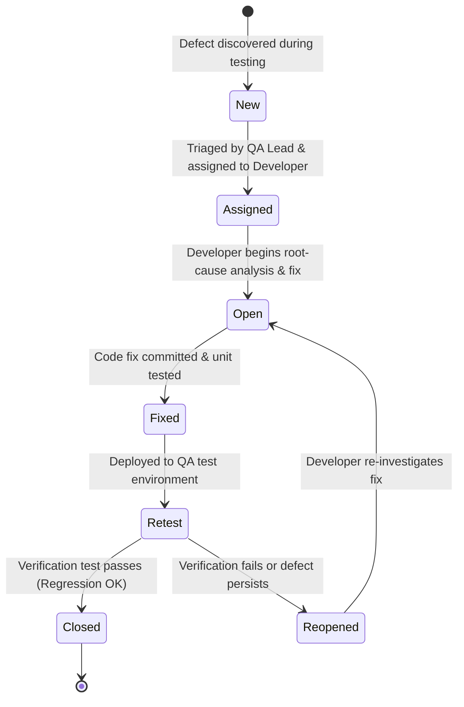

# Defect Lifecycle (Bug Life Cycle) — SRMS Quality Assurance

## 1. Overview
In the Student Result Management System (SRMS) STQA workflow, every identified defect is tracked through a formal state machine from discovery (`New`) to verification and closure (`Closed`), including regression handling (`Reopened`).

## 2. State Transition Diagram

## 3. Lifecycle States Explained

| State | Responsibility | Entry Criteria | Exit Criteria |
|---|---|---|---|
| **1. New** | QA Engineer / Automated Test Suite | A test case fails (`Actual Result != Expected Result`) and a structured Defect Report (`DEF-SRMS-XXX`) is logged with reproduction steps, severity, and priority. | QA Lead reviews the defect for validity and completeness. |
| **2. Assigned** | QA Lead / Project Architect | Defect is confirmed as valid (not a duplicate) and assigned to the responsible Python/Flask developer. | Developer acknowledges assignment and begins debugging. |
| **3. Open** | Developer | Developer reproduces the bug locally, inspects the root cause in `app/services/` or `app/routes/`, and designs a fix. | Fix is implemented and local unit tests pass. |
| **4. Fixed** | Developer | Code changes are applied and a corresponding regression test is added to `tests/`. | Build is handed off to QA for formal re-testing. |
| **5. Retest** | QA Engineer | QA executes the exact reproduction steps from the Defect Report along with the automated regression suite (`pytest -v`). | Test either passes (`-> Closed`) or fails (`-> Reopened`). |
| **6. Reopened** | QA Engineer | The defect still manifests during `Retest`, or the fix introduced a side-effect regression in related functionality. | Transitions back to `Open` with updated logs/tracebacks for the developer. |
| **7. Closed** | QA Engineer | The original failing test case and the entire regression suite pass with zero regressions. | Defect is archived in `docs/defect-report.md`. |

## 4. Severity vs. Priority Matrix Used in SRMS

| Level | Severity Definition (Technical Impact) | Priority Definition (Scheduling Urgency) |
|---|---|---|
| **1 — Critical / High** | Core calculation, grading, critical fail rule, or JSON storage corruption (`DEF-SRMS-001`). | Must be fixed immediately before any further feature work (`P1`). |
| **2 — Major / Medium** | Incorrect section analytics, missing validation, or broken route access restriction (`DEF-SRMS-002`, `DEF-SRMS-003`). | Must be fixed prior to release sign-off (`P2`). |
| **3 — Minor / Low** | UI alignment, repeated popup in same session, or cosmetic wording (`DEF-SRMS-004`). | Scheduled after critical and major defects are resolved (`P3`). |
